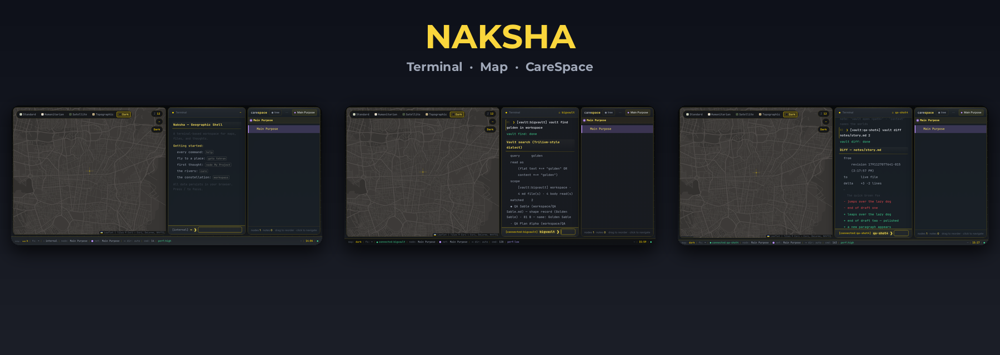
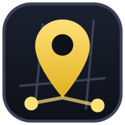

<p align="center">
  
</p>

<p align="center"></p>

<h1 align="center">Naksha · نقشه</h1>

<p align="center">
  A quiet workspace to think, plan and pin ideas on a map.<br>
  <a href="LICENSE">Apache-2.0</a> · by <a href="https://github.com/FontanisDev">Hamid Salehi</a>
</p>

---

## Quick start (English)

Naksha is a Next.js app. It runs locally in your browser.

**Requirements:** [Bun](https://bun.sh), Node.js 20 or newer.

1. Clone the repository.

   ```bash
   git clone https://github.com/FontanisDev/naksha.git
   cd naksha
   ```

2. Install dependencies and create the local database.

   ```bash
   cp .env.example .env
   bun install
   bun run db:push
   ```

3. Start the app.

   ```bash
   bun run dev
   ```

4. Open `http://localhost:3000`. Type `help` in the terminal.

**Optional: the nano editor bridge.** It lets you edit vault files with real `nano`.

```bash
cd mini-services/nano-pty
bun install
bun run start
```

The bridge listens on `127.0.0.1:3005`. Route it through the included `Caddyfile` (port 81).

**Useful commands:** `help` · `goto tehran` · `node My Project` · `care` · `workspace` · `vault connect /path/to/notes` · `vault doctor`

---

## درباره‌ی نقشه

نقشه یک فضای آرام برای فکر کردن است. من آن را برای کار خودم ساختم. کارم با نقشه، کتابخانه‌های جغرافیایی و دوقلوهای دیجیتال دنیای واقعی است.

نقشه جایگزین ابزارهای سنگین ثبت دانش نیست. هدفش گره‌زدن همه‌چیز به یک گراف عظیم نیست. جایی است برای نشستن، مرور کردن و آرام برنامه‌ریختن. روی نقشه سفر می‌کنید، شکل می‌کشید، نقطه می‌گذارید و ایده‌هایتان را کنار آن می‌نویسید.

## سه بخش اصلی

نقشه از سه بخش کنار هم ساخته شده است.

- **نقشه:** یک نقشه‌ی زنده با لایه‌های استاندارد، ماهواره‌ای، توپوگرافی و تیره.
- **ترمینال:** با فرمان‌های ساده به نقشه، فایل‌ها و یادداشت‌ها دسترسی دارید.
- **CareSpace:** یک گراف از فکرها. هر فکر یک گره است و می‌توانید گره‌ها را بچینید و به هم وصل کنید.

## دو دنیای جدا از هم

برنامه دو محل ذخیره‌سازی دارد. این دو هرگز با هم قاطی نمی‌شوند.

| دنیا | محل ذخیره | چه کسی می‌نویسد |
|---|---|---|
| `internal` | حافظه‌ی مرورگر (`localStorage`) | فرمان‌های ترمینال |
| `connected` | یک پوشه‌ی واقعی که خودتان وصل می‌کنید | هیچ‌کس، تا زمانی که اجازه بدهید |

فرمان `vault connect <مسیر>` تنها راه دیدن یک پوشه‌ی واقعی است. برنامه بی‌اجازه به فایل‌های شما دست نمی‌زند. پوشه‌ی وصل‌شده می‌تواند یک vault از یادداشت‌های Markdown باشد، مثل Obsidian.

با `vault find`، `vault diff` و `vault doctor` یادداشت‌ها را جست‌وجو می‌کنید، نسخه‌ها را مقایسه می‌کنید و وضعیت اتصال را می‌بینید. نسخه‌های قبلی هر فایل در پوشه‌ی `db/revisions` نگه‌داری می‌شود. خود vault دست‌نخورده می‌ماند.

## امنیت و اعتماد

نقشه یک ابزار شخصی و تک‌کاربره است. آن را روی دستگاه خودتان اجرا کنید. برنامه احراز هویت ندارد.

- خواندن vault فقط از مسیرهای `GET` انجام می‌شود. این مسیرها نوشتن ندارند.
- هر مسیر بیرون از پوشه‌ی وصل‌شده رد می‌شود. این شامل `../`، مسیر مطلق و symlink است.
- فایل‌های مخفی (مانند `.git`) دیده نمی‌شوند.
- نوشتن API فقط برای فایل‌های `.md` و فقط در vault تعیین‌شده انجام می‌شود. حداکثر حجم ۲ مگابایت است.
- پل nano فقط به `127.0.0.1` گوش می‌دهد. nano با گزینه‌ی `-R` در پوشه‌ی vault اجرا می‌شود و هیچ shell دخالت ندارد.

برای آزمایش خودتان این فرمان را اجرا کنید:

```bash
bun scripts/security-probe.ts
```

**محدودیت‌ها.** حالت `-R` در nano یک محافظ قوی است، اما جایگزین sandbox سطح سیستم‌عامل نیست. فاصله‌ی زمانی بین بررسی مسیر و عمل روی فایل وجود دارد. برای ابزار محلی تک‌کاربره این پذیرفتنی است. اگر مرورگر وسط ویرایش بسته شود، تغییرات ذخیره‌نشده از بین می‌رود.

## ساختار پروژه

```
src/                  برنامه‌ی Next.js (رابط، فرمان‌ها، API)
prisma/               طرح پایگاه‌داده‌ی SQLite
mini-services/        پل nano (WebSocket + PTY)
scripts/              بررسی امنیتی و ممیزی
public/               فونت‌ها و آیکن
docs/                 تصاویر README
Caddyfile             دروازه‌ی محلی برای پل nano
```

## مجوز

این پروژه با مجوز [Apache 2.0](LICENSE) منتشر شده است. استفاده، تغییر و انتشار آزاد است.

ساخته‌ی [حمید صالحی](https://github.com/FontanisDev)
